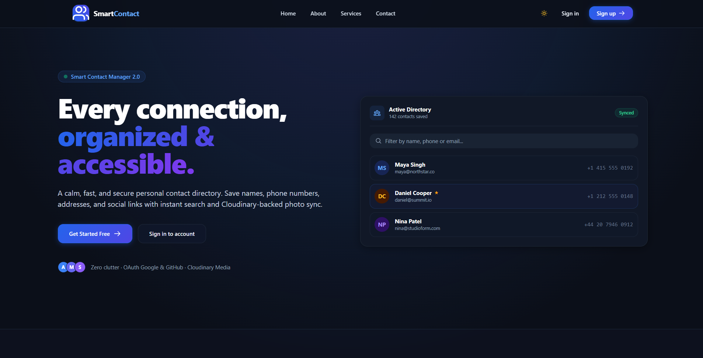
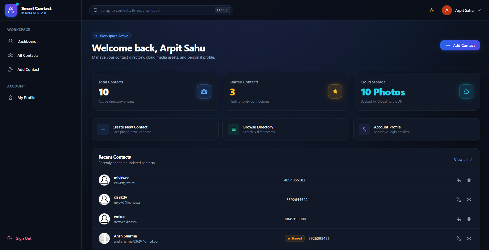
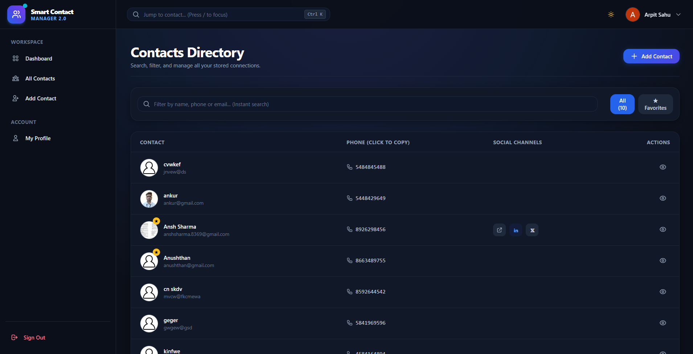
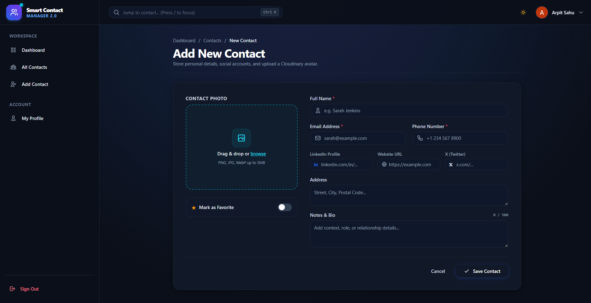
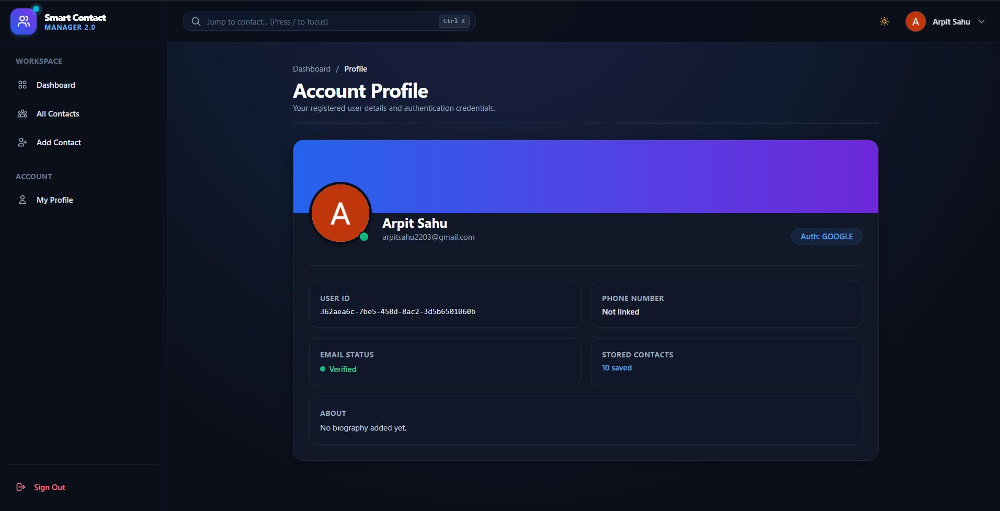
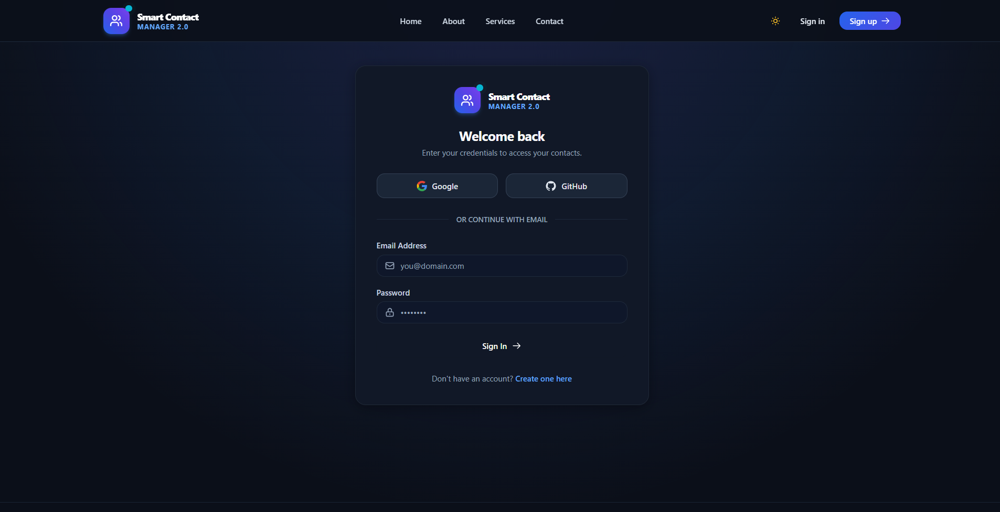
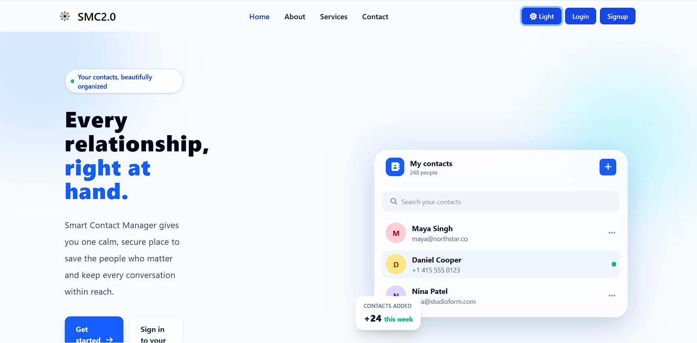

# Smart Contact Manager

Smart Contact Manager (SMC) is a Spring Boot web application for keeping personal contacts organized. It includes account authentication, contact profiles with Cloudinary-hosted images, and an email composer with Gmail delivery and optional Gemini-assisted drafting.

## Features

- Register and sign in with a password, Google OAuth2, or GitHub OAuth2.
- Create, view, update, search, favorite, and delete contacts.
- Store contact details, notes, social links, and profile images.
- Browse contacts with pagination and open contact details without reloading the page.
- Send emails through a connected Gmail account, attach files, and view sent-email history.
- Generate or polish email drafts with Google Gemini when an API key is configured.
- Update the signed-in user's profile.
- Responsive interface with light/dark theme support.

## Screenshots

| Page | Preview |
| --- | --- |
| Landing page |  |
| Dashboard |  |
| Contacts directory |  |
| Add contact |  |
| Profile |  |
| Login |  |
| About |  |

## Technology

- Java 21 and Spring Boot 4
- Spring MVC, Thymeleaf, Spring Security, and Spring Data JPA
- MySQL 8
- Google and GitHub OAuth2; Gmail API for sending email
- Cloudinary for contact images
- Google Gemini API for AI email drafts
- Vanilla JavaScript, Tailwind CSS, and Flowbite
- Docker Compose for running the application with MySQL

The shared page template loads Tailwind CSS and Flowbite from CDNs, so those frontend assets require browser internet access.

## Getting started

### Requirements

For a local run:

- Java 21
- MySQL 8
- Git

Maven is not required separately; the repository includes Maven Wrapper scripts. Docker Desktop with Docker Compose is an alternative to installing MySQL locally.

### 1. Get the code

```bash
git clone https://github.com/arpitsahu2203/SCM-Smart-Contact-Manager-.git
cd SCM-Smart-Contact-Manager-
```

### 2. Configure the environment

Copy `.env.example` to `.env` and replace the example values:

**PowerShell**

```powershell
Copy-Item .env.example .env
```

**Linux/macOS**

```bash
cp .env.example .env
```

The application reads these settings:

| Variable | Purpose |
| --- | --- |
| `DB_URL` | JDBC URL for MySQL; local default is `jdbc:mysql://localhost:3306/scm2` |
| `DB_USERNAME` | MySQL username |
| `DB_PASSWORD` | MySQL password |
| `GOOGLE_CLIENT_ID`, `GOOGLE_CLIENT_SECRET` | Google sign-in and Gmail access |
| `GITHUB_CLIENT_ID`, `GITHUB_CLIENT_SECRET` | GitHub sign-in |
| `CLOUDINARY_CLOUD_NAME`, `CLOUDINARY_API_KEY`, `CLOUDINARY_API_SECRET` | Contact image storage |
| `GEMINI_API_KEY`, `GEMINI_MODEL` | AI email drafting; model defaults to `gemini-3.8-flash` |

MySQL, Google, GitHub, Cloudinary, and Gemini settings should be set to valid credentials for the related features. Keep `.env` private and do not commit real credentials.

For OAuth2 sign-in, configure the local callback URL with the provider:

```text
http://localhost:8080/login/oauth2/code/google
http://localhost:8080/login/oauth2/code/github
```

### 3. Create the local database

Create the database named `scm2` in MySQL:

```sql
CREATE DATABASE scm2;
```

Hibernate is configured with `ddl-auto=update` and creates or updates the application's tables when it connects.

### 4. Run the application

**Windows PowerShell**

```powershell
.\mvnw.cmd spring-boot:run
```

**Linux/macOS**

```bash
./mvnw spring-boot:run
```

Open [http://localhost:8080/SMC/home](http://localhost:8080/SMC/home). The sign-in page is available at [http://localhost:8080/login](http://localhost:8080/login).

## Run with Docker

Docker Compose starts the Spring Boot application and MySQL. The Compose configuration reads `.env` from the repository root; set `DB_PASSWORD` there before starting.

```bash
docker compose up --build
```

Open [http://localhost:8080/SMC/home](http://localhost:8080/SMC/home). Compose overrides `DB_URL` inside the application container to connect to the MySQL service.

Stop the containers while preserving data:

```bash
docker compose down
```

To delete the MySQL database and stored email attachments as well, run:

```bash
docker compose down -v
```

**Warning:** `docker compose down -v` permanently removes the Docker volumes and their data.

## Tests and frontend assets

Run the Java test suite with:

```bash
./mvnw test
```

On Windows, use `.\mvnw.cmd test`. The Spring Boot context test uses the configured datasource, so MySQL must be available.

The optional Tailwind build scripts are defined in `package.json`:

```bash
npm install
npm run tw:build
```

`npm run tw:watch` runs the Tailwind watcher during frontend development.

## Routes

### Pages and account

| Method | Path | Purpose |
| --- | --- | --- |
| `GET` | `/SMC/home` | Landing page |
| `GET` | `/login` | Sign-in page |
| `GET` | `/SMC/register` | Registration page |
| `POST` | `/SMC/do-register` | Create an account |
| `GET` | `/SMC/user/dashboard` | User dashboard |
| `GET` | `/SMC/user/profile` | User profile |
| `GET` | `/SMC/user/Contact/view` | Paginated contacts directory |
| `GET`, `POST` | `/SMC/user/Contact/add` | Add a contact |
| `GET` | `/SMC/user/Contact/view/{id}` | Edit a contact |
| `POST` | `/SMC/user/Contact/update/{id}` | Save contact changes |

### JSON API

| Method | Path | Purpose |
| --- | --- | --- |
| `GET` | `/SMC/api/contacts/{id}` | Fetch contact details |
| `PUT` | `/SMC/api/contacts/{id}` | Update a contact |
| `DELETE` | `/SMC/api/contacts/{id}` | Delete a contact |
| `GET` | `/SMC/api/email/status` | Check Gmail connection status |
| `POST` | `/SMC/api/email/ai/generate` | Generate an email draft |
| `POST` | `/SMC/api/email/ai/refine` | Refine an email draft |
| `GET` | `/SMC/api/email/history/{contactId}` | Get sent-email history |

Requests under `/SMC/user/**` and `/SMC/api/**` require authentication. Contact API operations check that the contact belongs to the signed-in user.

## Project layout

```text
.
├── Dockerfile
├── docker-compose.yml
├── .dockerignore
├── .env.example
├── pom.xml
├── package.json
├── docs/
│   └── screenshots/
└── src/
    ├── main/
    │   ├── java/org/arpitsahu/smc/
    │   │   ├── Config/       # Security and application configuration
    │   │   ├── Controller/   # Page, contact, account, and email endpoints
    │   │   ├── Entities/     # JPA entities
    │   │   ├── Repository/   # Spring Data repositories
    │   │   ├── Services/     # Service interfaces
    │   │   ├── ServiceImpl/  # Service implementations
    │   │   ├── forms/        # Form models
    │   │   └── payload/      # API request and response models
    │   └── resources/
    │       ├── static/       # CSS, JavaScript, and images
    │       ├── templates/    # Thymeleaf views
    │       └── application.properties
    └── test/
```
